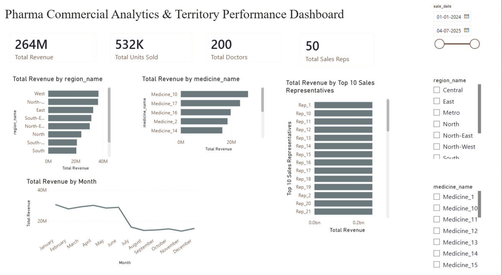

# Pharma Commercial Analytics & Territory Performance Dashboard

## Project Overview

This project analyzes pharmaceutical sales performance across multiple territories, products, physicians, and sales representatives using SQL and Power BI.

## Business Problem

Pharmaceutical companies need visibility into:

- Territory performance
- Product revenue contribution
- Doctor prescribing trends
- Sales representative effectiveness
- Revenue growth trends

## Dataset

- 5,000+ Sales Transactions
- 200 Doctors
- 50 Sales Representatives
- 20 Medicines
- 10 Regions

## Technologies Used

- MySQL
- SQL
- Power BI
- Excel

## KPIs

- Total Revenue
- Revenue by Territory
- Top Products
- Top Prescribing Doctors
- Sales Representative Performance
- Month-on-Month Growth

## Project Structure

dataset/
sql/
dashboard/
screenshots/
documentation/

## Dashboard Preview

